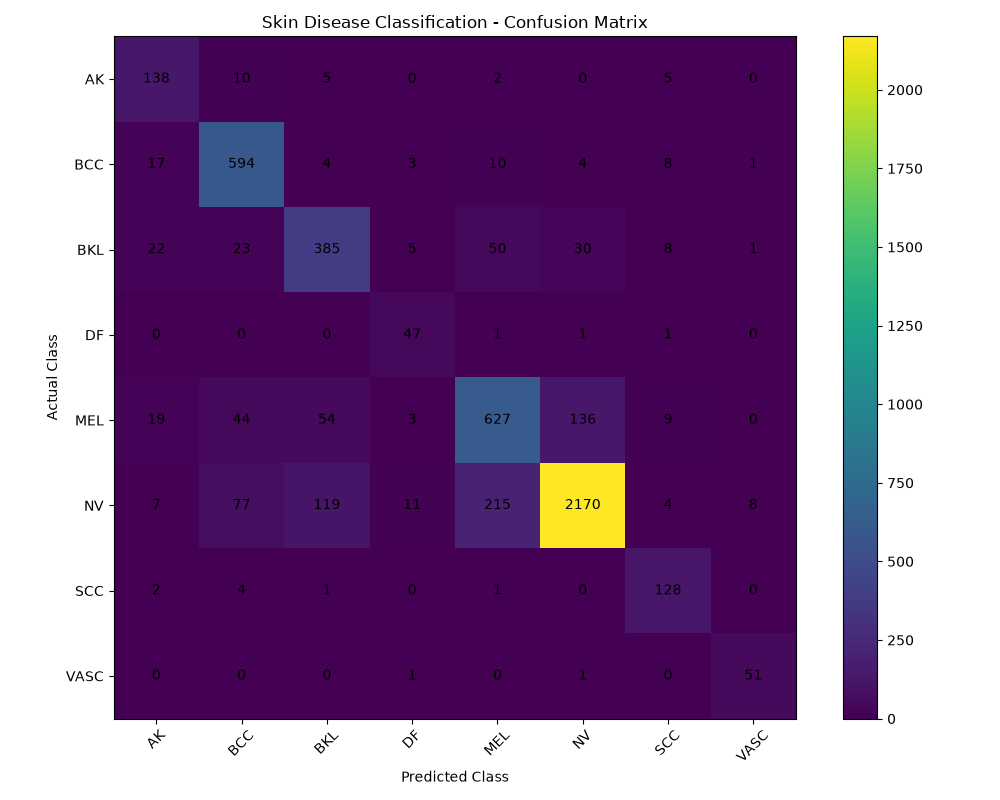

Multi-Attribute Skin Disease Detection and Treatment Recommendations Using Deep Learning

A web application that analyses an uploaded skin image and gives the skin status (normal or diseased), the predicted disease, a confidence score, and medicinal plant based treatment information.

It uses a two-stage ResNet18 model built with PyTorch, and a Flask web app with SQLite for user login.

Disclaimer: This project is for education and preliminary research only. It is not a medical diagnosis tool. Please consult a qualified doctor.

Results

Stage 2 (8-class disease classifier), tested on 5,067 validation images:
- Accuracy: 81.71 percent
- Weighted precision: 82.70 percent
- Weighted F1-score: 81.91 percent
- Macro F1-score: 80.28 percent

Stage 1 (normal or diseased detector), tested on 200 validation images:
- Final validation accuracy: 99.50 percent

Rare classes reached high recall: dermatofibroma 94.0 percent, squamous cell carcinoma 94.1 percent and vascular lesions 96.2 percent. Melanoma and benign keratosis-like lesions are the weakest classes, with F1-scores of about 70 percent. The Stage 1 validation set is small, so its accuracy may not hold on every real-world photo.

How It Works

1. The user uploads a skin image.
2. The image is resized to 224 by 224 pixels and normalised.
3. Stage 1 (ResNet18) decides whether the skin is normal or diseased.
4. If normal, the app shows Normal Skin with its confidence.
5. If diseased, Stage 2 (ResNet18) predicts one of eight disease classes with its confidence.
6. The user can open a treatment page with medicinal plant information and skin care guidance.

Checking for normal skin first avoids giving a disease label to healthy skin.

Disease Classes

- AK: Actinic Keratosis
- BCC: Basal Cell Carcinoma
- BKL: Benign Keratosis-like Lesions
- DF: Dermatofibroma
- MEL: Melanoma
- NV: Melanocytic Nevus
- SCC: Squamous Cell Carcinoma
- VASC: Vascular Lesions

Features

- User registration and login with hashed passwords and sessions
- Skin image upload, with the image shown beside the result
- Two-stage prediction with confidence percentage
- Treatment page with medicinal plant information (Aloe Vera, Turmeric, Neem, Green Tea), skin care guidance and a medical advisory
- User profile page

Dataset

- Disease images: 25,319 labelled images in 8 classes (class names and counts follow the ISIC 2019 challenge)
- Class imbalance: 12,875 nevus images against 239 dermatofibroma images
- Normal skin: 499 images collected from public web sources, not clinically verified
- Stage 1 set: 1,000 images (500 normal and 500 diseased), split into 800 for training and 200 for validation

The dataset is not included in this repository.

Training Details (8-class model)

- Base model: ResNet18 pretrained on ImageNet, final layer replaced with 8 outputs
- Data split: 80 percent training and 20 percent validation, stratified
- Class balancing: weighted random sampler
- Augmentation: flips, rotation up to 20 degrees, colour changes
- Optimizer: AdamW with learning rate 0.0001, cosine annealing schedule
- Batch size 16, trained for 5 epochs
- Best weights are saved using validation macro F1-score

Tech Stack

Python, PyTorch, torchvision, ResNet18, Flask, SQLite, HTML, CSS, JavaScript, Pillow, scikit-learn, NumPy

Run Locally

Download the project and install the requirements:

git clone https://github.com/Shibia-eel/Skin-Disease-Detection-Using-Deep-Learning.git
cd Skin-Disease-Detection-Using-Deep-Learning
pip install -r requirements.txt

Start the app:

python app.py

Then open http://127.0.0.1:5000 in your browser.

The project folder must contain normal_skin_detector.pth, resnet18_skin_model_improved.pth and class_names.json.

To test the model from the command line, run python prediction.py and enter the path of a skin image.

To retrain the 8-class model, place the images in datasets/dataset_8class with one folder per class, then run python train_resnet18_improved.py.

Project Structure

- app.py: Flask app with routes, login and upload
- prediction.py: two-stage prediction module
- train_resnet18_improved.py: training script for the 8-class model
- evaluate_model.py: evaluation and confusion matrix
- class_names.json: disease class names
- normal_skin_detector.pth: Stage 1 weights
- resnet18_skin_model_improved.pth: Stage 2 weights
- templates: HTML pages
- confusion_matrix.png: confusion matrix of the 8-class model
- requirements.txt: Python dependencies

Limitations and Future Work

- The treatment page shows the same general information for every disease class
- Melanoma and nevus are still confused with each other
- The normal skin data is small and collected from the web
- Planned improvements: disease-specific treatment information, stronger models, Grad-CAM explanations, prediction history and better security

Author

Shibia A, MCA, Hindusthan College of Engineering and Technology
LinkedIn: https://www.linkedin.com/in/a-shibia-53b16531a
