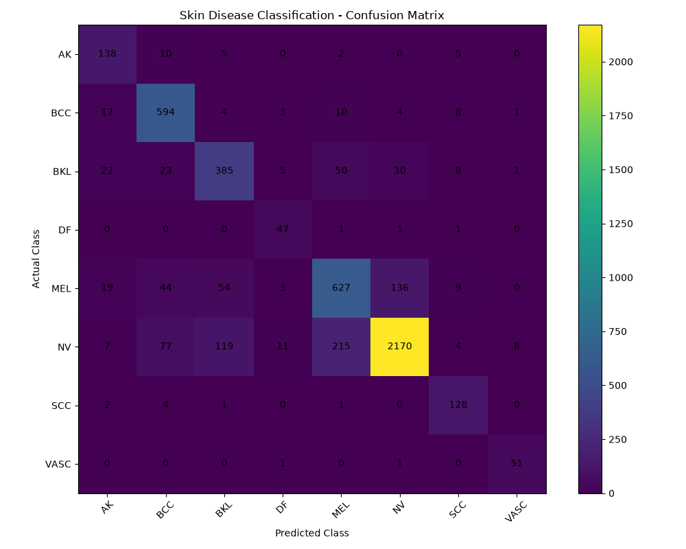

# Multi-Attribute Skin Disease Detection and Treatment Recommendations Using Deep Learning

A web application that analyses an uploaded skin image and returns the **skin status** (normal or diseased), the **predicted disease class**, a **confidence score**, and **medicinal plant-based treatment information**.

Built with a two-stage **ResNet18** pipeline in **PyTorch** and served through a **Flask** web app with **SQLite** user authentication.

> **Disclaimer:** This project is for educational and preliminary research purposes only. It is not a medical diagnosis tool. Always consult a qualified doctor.

---

## Results

| Model | Evaluation set | Result |
|-------|----------------|--------|
| Stage 2: 8-class disease classifier | 5,067 validation images | **81.71% accuracy**, 82.70% weighted precision, 81.91% weighted F1, 80.28% macro F1 |
| Stage 1: Normal vs Diseased detector | 200 validation images | 99.50% final validation accuracy |

Rare classes reached high recall (DF 94.0%, SCC 94.1%, VASC 96.2%) thanks to balanced sampling. Melanoma and BKL are the weakest classes (F1 of about 70%), and melanoma and nevus are the most frequently confused pair.



> The Stage 1 validation set is small, so its accuracy does not guarantee the same performance on every real-world photo.

---

## How It Works

```
Upload skin image
      |
Pre-processing (resize 224x224, normalise)
      |
Stage 1: ResNet18 -> Normal or Diseased?
      |-- Normal   -> "Normal Skin" + confidence
      |-- Diseased -> Stage 2: ResNet18 -> one of 8 disease classes + confidence
                          |
                   Treatment recommendation page
```

Checking for normal skin first avoids forcing a disease label onto healthy skin.

## Disease Classes

| Code | Disease |
|------|---------|
| AK | Actinic Keratosis |
| BCC | Basal Cell Carcinoma |
| BKL | Benign Keratosis-like Lesions |
| DF | Dermatofibroma |
| MEL | Melanoma |
| NV | Melanocytic Nevus |
| SCC | Squamous Cell Carcinoma |
| VASC | Vascular Lesions |

## Features

- User registration and login with hashed passwords (Werkzeug) and session-based access control
- Skin image upload with the image shown beside the result
- Two-stage prediction with confidence percentage
- Treatment page with medicinal plant information (Aloe Vera, Turmeric, Neem, Green Tea), general skin-care guidance and a medical advisory
- User profile page

## Dataset

- **Disease images:** 25,319 labelled lesion images across 8 classes (class names and counts follow the ISIC 2019 challenge)
- **Class imbalance:** 12,875 nevus images versus 239 dermatofibroma images
- **Normal skin:** 499 images collected from public web sources (not clinically verified)
- **Stage 1 set:** 1,000 images (500 normal, 500 diseased), split 800 train / 200 validation

The dataset is not included in this repository.

## Training Details (8-class model)

| Parameter | Value |
|-----------|-------|
| Base model | ResNet18 pretrained on ImageNet, final layer replaced (512 to 8) |
| Split | 80% train / 20% validation (stratified, random_state = 42) |
| Class balancing | WeightedRandomSampler (inverse class frequency) |
| Augmentation | Flips, rotation up to 20 degrees, colour jitter |
| Optimizer | AdamW (lr 0.0001, weight decay 0.0001), cosine annealing |
| Batch size / epochs | 16 / 5 |
| Model selection | Best validation macro F1 |

## Tech Stack

Python, PyTorch, torchvision, ResNet18 (CNN), Flask, SQLite, HTML, CSS, JavaScript, Pillow, scikit-learn, NumPy

## Run Locally

```bash
git clone https://github.com/Shibia-eel/Skin-Disease-Detection-Using-Deep-Learning.git
cd Skin-Disease-Detection-Using-Deep-Learning

pip install flask torch torchvision pillow scikit-learn numpy

python app.py
```

Then open `http://127.0.0.1:5000` in your browser.

The app needs these files in the project folder: `normal_skin_detector.pth`, `resnet18_skin_model_improved.pth` and `class_names.json`.

### Test the model from the command line

```bash
python prediction.py
```

Enter the path of a skin image when asked. The script prints the skin status, the predicted disease and the confidence for both stages.

### Retrain the 8-class model

Arrange the dataset with one folder per class:

```
datasets/dataset_8class/
  AK/  BCC/  BKL/  DF/  MEL/  NV/  SCC/  VASC/
```

Then run:

```bash
python train_resnet18_improved.py
```

The script uses a stratified 80/20 split, balances classes with a weighted sampler, and saves the weights with the best validation macro F1 to `resnet18_skin_model_improved.pth`.

## Project Structure

```
app.py                          Flask app (routes, login, upload)
prediction.py                   Two-stage prediction module
train_resnet18_improved.py      Training script for the 8-class model
evaluate_model.py               Evaluation (confusion matrix, metrics)
class_names.json                Disease class names
normal_skin_detector.pth        Stage 1 weights (normal / diseased)
resnet18_skin_model_improved.pth  Stage 2 weights (8 classes)
templates/                      HTML pages (home, login, register, predict, result, treatment, profile)
confusion_matrix.png            Confusion matrix of the 8-class model
requirements.txt                Python dependencies
```

## Limitations and Future Work

- The treatment page shows the same general information for every disease class
- Melanoma and nevus are still confused with each other
- Normal-skin data is small and web-collected
- Planned: disease-specific treatment information, stronger architectures, Grad-CAM explanations, prediction history, and security hardening (CSRF protection, environment-based secret key)

## Author

**Shibia A** | MCA, Hindusthan College of Engineering and Technology
[LinkedIn](https://www.linkedin.com/in/a-shibia-53b16531a)
